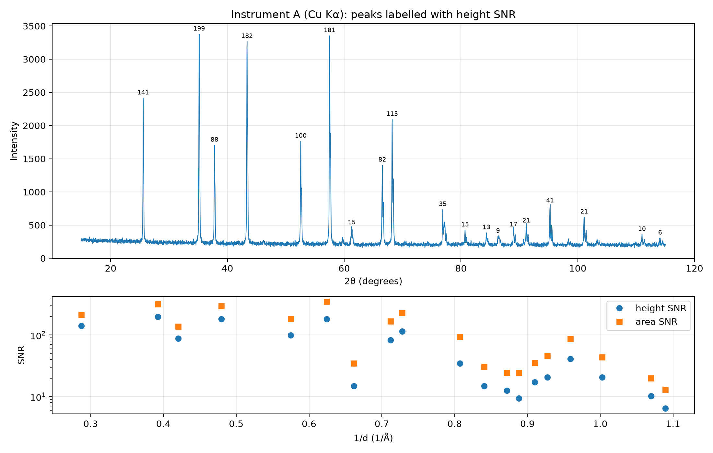
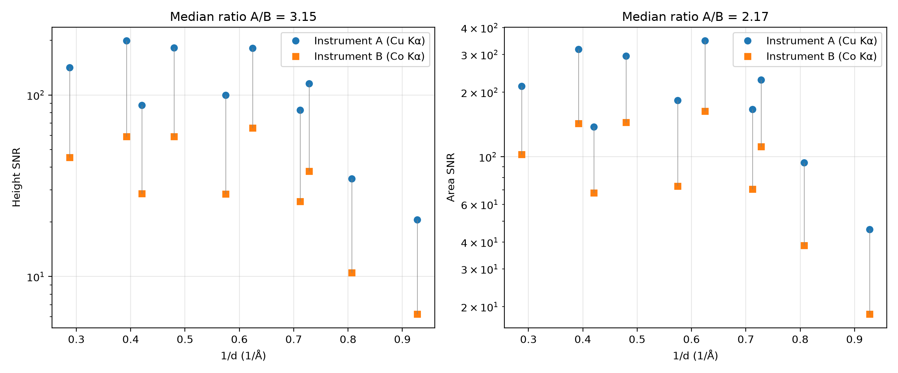

# xrd-snr

A Python script that calculates the signal-to-noise ratio (SNR) of peaks in X-ray powder diffraction patterns.

- **One pattern:** the SNR of every peak.
- **Two patterns of the same sample:** the SNR of the same reflections measured on two instruments, side by side. The instruments may use different X-ray tubes (for example Cu Kα and Co Kα), because reflections are matched by d-spacing.

| One pattern | Two patterns |
|---|---|
|  |  |

The example figures were made from synthetic data.

## Requirements

Python 3 with numpy and matplotlib:

```bash
pip install -r requirements.txt
```

## How to use

Open `xrd_snr.py` and edit the settings at the top:

```python
FILE_A = "pattern_A.xy"     # first pattern: 2-theta (degrees) and intensity
ANODE_A = "Cu"              # X-ray tube: Cu, Co, Mo, Fe, Cr or Ag
NAME_A = "Instrument A"
TIME_A = None               # total measuring time in seconds, or None

FILE_B = None               # second pattern for a comparison, or None for one pattern only
ANODE_B = "Co"
NAME_B = "Instrument B"
TIME_B = None
```

Then run:

```bash
python xrd_snr.py
```

The results are printed and a figure is saved as `xrd_snr.png`.

**Input files:** text files with 2θ in degrees in the first column and intensity in the second (`.xy`, `.txt`, `.csv`, …). Lines that are not numbers, such as headers, are skipped. Raw and background-subtracted data both work.

**Measuring time:** for a scanning detector, the total time is time per step × number of steps. For a 2D detector, it is exposure time × number of frames.

## What is calculated

For each peak:

- **Noise:** first, all points that belong to no peak are marked as baseline. A peak covers from 2.5 widths below its Kα1 position to 2.5 widths above its Kα2 position. A straight line is fitted through the baseline points near the peak (at least 100 points), and the noise is the standard deviation around that line.
- **Height:** the peak top above that line. A parabola is fitted to the logarithm of the points above 70 % of the maximum, so the result does not depend on whether a data point happens to sit on the exact top.
- **Area:** the sum of the points from 1.5 widths below Kα1 to 1.5 widths above Kα2. Its uncertainty is `noise × √(N × (1 + 2ρ))`, where N is the number of points and ρ is the correlation between neighbouring points. ρ is about 0 for a scanning detector and often 0.2–0.4 for data integrated from a 2D detector image. The script measures it from the baseline.
- **Height SNR** = height / noise. **Area SNR** = area / its uncertainty.

Where Kα1 and Kα2 are resolved, the Kα2 line is not counted as a separate peak.

For two patterns:

- Reflections are matched when their d-spacings differ by less than 0.3 %, and each peak is used once.
- The result is the **median** of the per-reflection ratios A/B, with a 95 % range from bootstrap resampling.
- If both measuring times are given, the ratio is also given per √second. SNR grows with the square root of measuring time, so this is the number to use when asking which instrument is better.

## Example output

One pattern:

```
Instrument A (Cu Kα): 19 peaks with height SNR >= 5

  2theta     d (A)     height    noise   height SNR  area SNR
  25.580    3.4795       2192     15.5       141.3     213.4
  35.160    2.5503       3064     15.4       198.7     317.1
  ...
```

Two patterns:

```
              height SNR                area SNR
   d (A)      A       B     A/B       A       B     A/B
  1.0783    20.6     6.2   3.32     45.8    18.4   2.49
  1.2390    34.6    10.5   3.30     93.9    38.6   2.43
  ...
Height SNR: median A/B = 3.15  (95 % range 3.07 to 3.34), A higher on 10 of 10 reflections
Area SNR: median A/B = 2.17  (95 % range 2.05 to 2.46), A higher on 10 of 10 reflections
```

## Accuracy

The script was tested on synthetic patterns where the true noise and peak heights are known: 14 peaks including a crowded group, noise that changes along the scan, and 5 different noise samples for each case.

| Peaks | Average error of height SNR | Typical scatter |
|---|---|---|
| Gaussian, FWHM 0.08° | +2 % | 8 % |
| Lorentzian, FWHM 0.08° | −3 % | 10 % |
| Gaussian, FWHM 0.25° | +1 % | 7 % |

No false peaks were found for sharp peaks. In a comparison where the true ratios were known (height 3.00, area 4.02, with correlated noise in one pattern), the script gave 3.04 and 3.95.

The scatter is not a fault of the method. The noise is itself measured from noisy data (about ±7 % with 100 points), and weak peaks have noisy tops.

## Things to know

- **Overlapping reflections.** Two reflections closer than about one peak width look like one peak and are measured as one. No method can separate them without knowing the crystal structure. This happens more often for broad peaks.
- **Very weak peaks.** Peaks just above `MIN_SNR` have noisy tops, so their individual SNR can be off by 20–30 %. The median over many peaks is reliable.
- **Without measuring times,** a comparison ranks the two measurements, not the two instruments.
- **Height vs area.** If the height ratio is clearly larger than the area ratio, part of the difference comes from sharper peaks (resolution), not from more counts.

## License

MIT, see [LICENSE](LICENSE).
